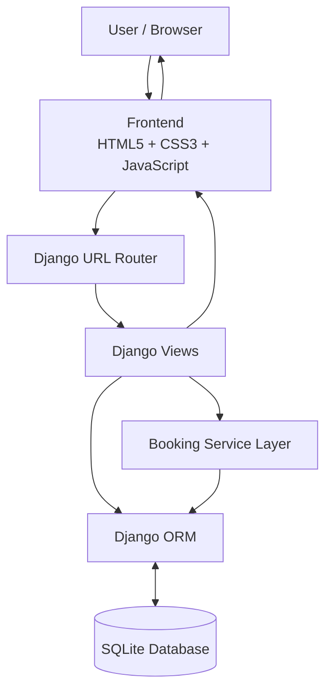
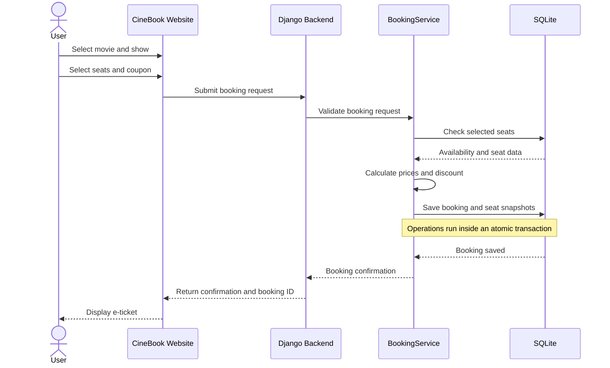
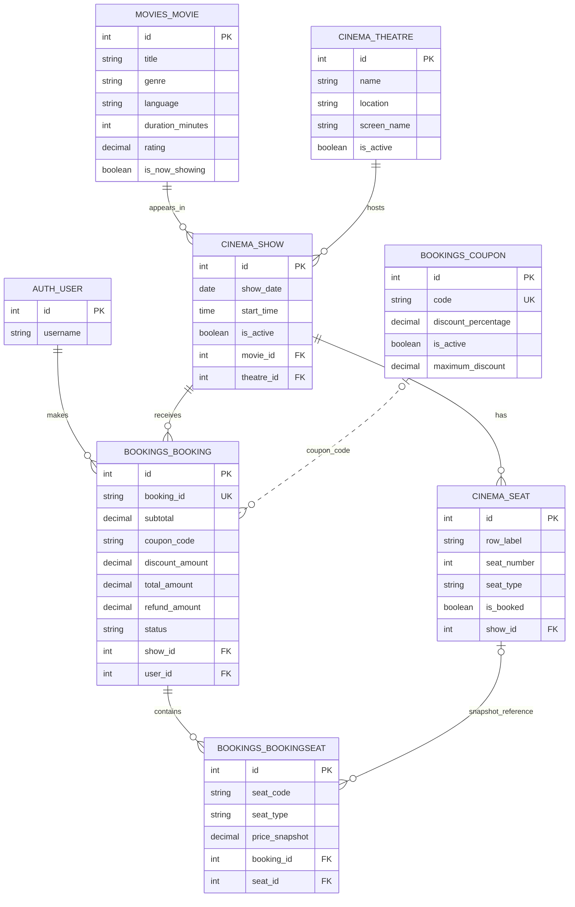
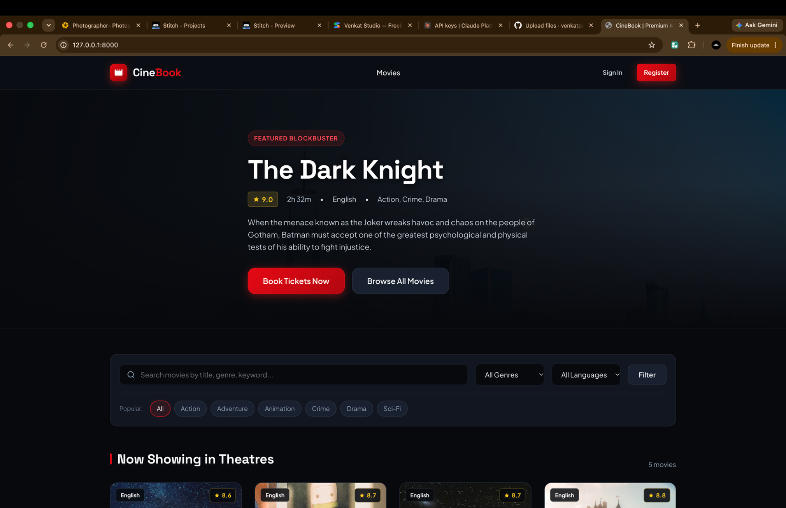
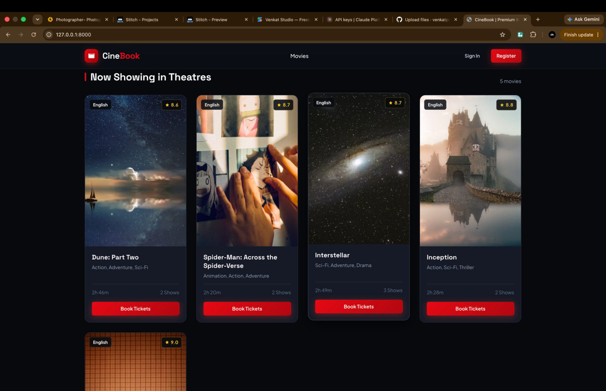
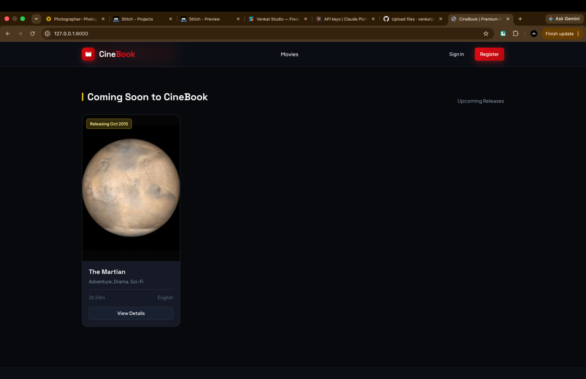

<div align="center">

# 🎬 CineBook

### A Full-Stack Movie Ticket Booking System

**Discover movies · Select seats · Book tickets · Manage reservations**


[Features](#-features) · [Tech Stack](#-technology-stack) · [Architecture](#-system-architecture) · [Database](#-database-design) · [Setup](#-getting-started) · [Testing](#-testing)

</div>

---

## 📌 About the Project

**CineBook** is a full-stack movie ticket booking web application developed using **Python, Django, SQLite, HTML5, CSS3, and vanilla JavaScript**.

The application provides a cinema-style experience where users can discover movies, view showtimes, select seats, apply a discount coupon, confirm bookings, print e-tickets, and cancel their own bookings.

The interface uses a **midnight-black background, cinematic-red actions, and warm-gold highlights**, inspired by modern movie-streaming and ticket-booking platforms.

> **Implementation note:** CineBook is implemented in Python/Django. The project demonstrates object-oriented programming principles that are also commonly taught in Java OOP courses; it is not a Java/Spring application.

## ✨ Features

### 🎞️ Movie Discovery
- Featured movie hero section.
- Separate **Now Showing** and **Coming Soon** sections.
- Search movies by title, genre, or keyword.
- Filter by genre and language.
- Movie detail pages with synopsis, metadata, and showtime selection.

### 💺 Interactive Seat Selection
- A separate **5 × 8 seat layout (40 seats)** for each show.
- Seat rows are labelled A–E and columns 1–8.
- Seat categories and configured prices:

| Category | Rows | Price |
|---|---|---:|
| Regular | A–B | ₹150 |
| Premium | C–D | ₹250 |
| VIP | E | ₹400 |

- Available, selected, and booked/unavailable visual states.
- Live selected-seat count and estimated total.
- Server-side seat availability and price validation.

### 🎟️ Booking and Discounts
- Supports booking one or multiple seats.
- Generates unique sequential booking references such as `BK1001`.
- `CINE10` coupon applies a 10% discount, subject to coupon validity and maximum-discount rules.
- Uses Django database transactions for all-or-nothing booking operations.

### ↩️ Cancellation and E-Tickets
- Authenticated users can view and cancel their own confirmed bookings.
- Cancellation refund is **80% of the amount paid**; the remaining 20% is retained as a cancellation fee.
- Cancelled seats are released for future bookings.
- Historical seat details are retained in booking-seat snapshots.
- Printable e-ticket with booking details and a barcode-style visual.

### 🔐 Authentication and Security
- Custom registration and login pages.
- Booking ownership checks prevent users from viewing or cancelling another user's ticket.
- Server-side validation of seat codes, availability, and prices.
- CSRF protection for state-changing forms and requests.
- XSS protection practices through Django's template and request-handling mechanisms.

---

## 🧰 Technology Stack

| Layer | Technology | Responsibility |
|---|---|---|
| Frontend | HTML5 | Page structure |
| Styling | CSS3 | Layout, responsive styling, cinema theme |
| Browser interaction | Vanilla JavaScript | Seat selection, live totals, UI interactions |
| Backend | Python | Application logic |
| Web framework | Django | Routing, views, authentication, ORM, validation |
| Database | SQLite | Persistent application data |
| Testing | Django test framework | Automated unit and integration tests |

---

## 🏛️ System Architecture

The browser communicates with Django. Django validates the request and uses the Django ORM to read or update SQLite.



### Typical Booking Flow



---

## 🗃️ Database Design

CineBook uses SQLite through Django's ORM. The uploaded database contains the following application tables and relationships.

### Entity Relationship Diagram



### Main Application Tables

| Table | Purpose | Important fields |
|---|---|---|
| `movies_movie` | Movie catalogue | `title`, `genre`, `language`, `duration_minutes`, `rating` |
| `cinema_theatre` | Theatre details | `name`, `location`, `screen_name` |
| `cinema_show` | Movie show schedule | `show_date`, `start_time`, `movie_id`, `theatre_id` |
| `cinema_seat` | Seats belonging to each show | `row_label`, `seat_number`, `seat_type`, `is_booked`, `show_id` |
| `bookings_booking` | Main booking record | `booking_id`, `subtotal`, `discount_amount`, `total_amount`, `status`, `user_id`, `show_id` |
| `bookings_bookingseat` | Seat details captured for a booking | `seat_code`, `seat_type`, `price_snapshot`, `booking_id`, `seat_id` |
| `bookings_coupon` | Coupon configuration | `code`, `discount_percentage`, `is_active`, `valid_from`, `valid_until`, `maximum_discount` |
| `auth_user` | Django user accounts | `username`, `email`, authentication fields |

### Database Snapshot

The supplied `db.sqlite3` file was inspected while preparing this README. At that time, it contained:

| Application data | Records in supplied database |
|---|---:|
| Movies | 6 |
| Theatres | 2 |
| Shows | 91 |
| Seats | 3,640 |
| Bookings | 8 |
| Booking-seat snapshots | 20 |
| Coupons | 1 |
| Django users | 3 |

These are counts from the uploaded database snapshot, not fixed limits. The values can change as the application is used.

### Important Database Rules
- Each seat belongs to a specific show.
- A uniqueness constraint prevents duplicate row/seat positions within the same show.
- Each booking has a unique booking reference.
- Booking-seat snapshots preserve the seat code, category, and price recorded at booking time.
- A show has its own independent seat inventory.

---

## 🧠 Object-Oriented Programming Concepts

The project applies OOP and software design principles using Python classes and Django models.

| OOP / Design Concept | CineBook implementation |
|---|---|
| Enum | `SeatType(Enum)` stores seat code, label, price, and row mapping. |
| Abstract contract | `Bookable(ABC)` declares `book_seats()` and `cancel_booking()`. |
| Inheritance | `BookingService` implements the `Bookable` contract. |
| Service Layer | `BookingService` keeps booking, cancellation, transaction, and refund logic outside the views. |
| Composition | A theatre has multiple shows; each show has its own seats. |
| Two-dimensional array | `build_seat_matrix_2d()` creates the 5 × 8 seat matrix using nested loops. |
| Optional arguments | `calculate_total(seats, coupon_code=None)` supports totals with or without a coupon. |
| Historical snapshot | `BookingSeat` stores the seat code, type, and price at booking time. |

### Seat Matrix Example

```text
                 SCREEN THIS WAY

        1    2    3    4    5    6    7    8
      +---------------------------------------+
 A    | A1 | A2 | A3 | A4 | A5 | A6 | A7 | A8 |  Regular
 B    | B1 | B2 | B3 | B4 | B5 | B6 | B7 | B8 |  Regular
 C    | C1 | C2 | C3 | C4 | C5 | C6 | C7 | C8 |  Premium
 D    | D1 | D2 | D3 | D4 | D5 | D6 | D7 | D8 |  Premium
 E    | E1 | E2 | E3 | E4 | E5 | E6 | E7 | E8 |  VIP
      +---------------------------------------+
```

---

## 🔄 CRUD Operations

CRUD stands for **Create, Read, Update, and Delete**. These are the basic operations used to manage database records.

| Operation | Meaning | CineBook example |
|---|---|---|
| Create | Insert a new record | Create a booking and its booking-seat records |
| Read | Retrieve records | Display movies, shows, seat availability, and a user's bookings |
| Update | Change an existing record | Update booking status on cancellation and release seats |
| Delete | Remove a record | Database records may be deleted through applicable administrative/model operations; normal booking cancellation preserves the booking history |

**Note:** Normal cancellation is not a permanent deletion of the booking. CineBook updates the booking's status, records cancellation/refund information, releases the seats, and preserves historical seat snapshots.

---

## 🖼️ Application Screenshots

The screenshots below are from the supplied running CineBook application.

### 1. Featured Movie and Home Page


### 2. Now Showing Movies


### 3. Coming Soon Movies


> To make the README even more complete, add screenshots of the actual seat-selection page, login/register page, booking confirmation, cancellation result, and database tables to `docs/images/`, then embed them here.

---

## 🔐 Security and Transaction Handling

- **Authentication:** Users register and log in before accessing protected booking actions.
- **Ownership verification:** Users can view or cancel only their own bookings.
- **Server-side validation:** Seat codes, availability, and prices are checked by the backend. Browser-submitted prices are not trusted.
- **Atomic transactions:** Booking and cancellation operations use Django's `transaction.atomic()` to prevent partial updates.
- **Seat locking:** The service layer uses `select_for_update()` for locking where supported by the database.
- **CSRF protection:** State-changing forms and Fetch API requests require valid CSRF tokens.
- **SQLite concurrency note:** SQLite uses database-level locking rather than PostgreSQL-style row-level locking. PostgreSQL is the recommended option for a high-traffic production deployment.

---

## 🧪 Testing

The project README documents **18 automated unit and integration test scenarios**, covering:

1. Seat category mapping and pricing.
2. Booking a single seat.
3. Booking multiple seats.
4. Invalid seat codes.
5. Duplicate seat codes.
6. Booking an already-booked seat.
7. All-or-nothing transaction behaviour.
8. `CINE10` coupon calculation.
9. Invalid coupon rejection.
10. Unique booking ID generation.
11. Independent seat grids across different shows.
12. Cancellation and 80% refund calculation.
13. Prevention of duplicate cancellations.
14. Seat availability after cancellation.
15. Prevention of unauthorized cancellation.
16. Prevention of unauthorized ticket viewing.
17. 2D seat matrix structure.
18. End-to-end booking API flow.

Run the tests with:

```bash
python manage.py test
```

---

## 🚀 Getting Started

### Prerequisites

- Python 3.10 or later.
- `pip`.
- Git.

### 1. Clone the repository

```bash
git clone https://github.com/YOUR-USERNAME/YOUR-REPOSITORY.git
cd YOUR-REPOSITORY
```

Replace the URL and folder name with your actual GitHub repository details.

### 2. Create and activate a virtual environment

**macOS / Linux**

```bash
python3 -m venv .venv
source .venv/bin/activate
```

**Windows PowerShell**

```powershell
python -m venv .venv
.venv\Scripts\Activate.ps1
```

### 3. Install dependencies

```bash
pip install -r requirements.txt
```

### 4. Apply database migrations

```bash
python manage.py makemigrations
python manage.py migrate
```

### 5. Load the initial CineBook data

```bash
python manage.py seed_cinebook
```

The documented seed command creates sample movies, theatres, shows, seats, a `CINE10` coupon, and a demo account.

**Demo account documented in the project:**

```text
Username: cinefan
Password: Cinebook@2026
```

For safety, change or remove demo credentials before deploying publicly. Never commit real passwords, secret keys, or production `.env` files to GitHub.

### 6. Run automated tests

```bash
python manage.py test
```

### 7. Start the development server

```bash
python manage.py runserver
```

Open:

```text
http://127.0.0.1:8000/
```

To access the development server from another device on the same Wi-Fi:

```bash
python manage.py runserver 0.0.0.0:8000
```

Then open `http://YOUR-LAN-IP:8000/` on that device.

---

## 📁 Project Structure

```text
cinebook/
├── manage.py
├── requirements.txt
├── README.md
├── .env.example
├── config/
│   ├── settings.py
│   ├── urls.py
│   ├── views.py
│   ├── wsgi.py
│   └── asgi.py
├── core/
│   ├── enums.py
│   ├── interfaces.py
│   └── utils.py
├── movies/
│   ├── models.py
│   ├── views.py
│   └── urls.py
├── cinema/
│   ├── models.py
│   ├── views.py
│   ├── urls.py
│   └── management/
│       └── commands/
│           └── seed_cinebook.py
├── bookings/
│   ├── models.py
│   ├── views.py
│   ├── services.py
│   ├── forms.py
│   └── tests.py
├── templates/
│   ├── base.html
│   ├── movies/
│   ├── cinema/
│   ├── bookings/
│   └── registration/
├── static/
│   ├── css/
│   │   └── style.css
│   └── js/
│       ├── app.js
│       └── seat-map.js
└── docs/
    └── images/
        ├── homepage-featured.png
        ├── now-showing.png
        └── coming-soon.png
```

---

## 🔮 Possible Future Enhancements

- Integrate a real payment gateway.
- Add email booking confirmations.
- Add QR-code ticket verification.
- Deploy with PostgreSQL for production workloads.
- Add an admin analytics dashboard.
- Add automated deployment and monitoring.

These are possible future improvements and are not claimed as currently implemented features.

---

## 👥 Team and Academic Information

**Project:** CineBook – Full-Stack Movie Ticket Booking System  
**Domain:** Web Application Development  
**Backend:** Python and Django  
**Database:** SQLite  

Add your actual team details below:

| Role | Team member |
|---|---|
| Project member 1 | Your Name |
| Project member 2 | Team Member Name |
| Project member 3 | Team Member Name |
| Project member 4 | Team Member Name |

---

## 📄 License

This project was developed for academic and learning purposes. Add a license file if you intend to distribute the project under a specific open-source license.

<div align="center">

### 🎬 CineBook — Your Seat. Your Movie. Your Experience.

**Made with Python, Django, SQLite, HTML, CSS, and JavaScript.**

</div>
<div align="center">

# 🎬 CineBook

### A Full-Stack Movie Ticket Booking System

**Discover movies · Select seats · Book tickets · Manage reservations**



</div>
## 🖼️ Application Screenshots

### 1. CineBook Homepage


### 2. Now Showing Movies


### 3. Coming Soon Movies

TICKET-BOOKING-WEBSITE-/
│
├── README.md
├── homepage-featured.png
├── now-showing.png
├── coming-soon.png
├── manage.py
├── requirements.txt
├── db.sqlite3
└── cinebook_final_project.zip
