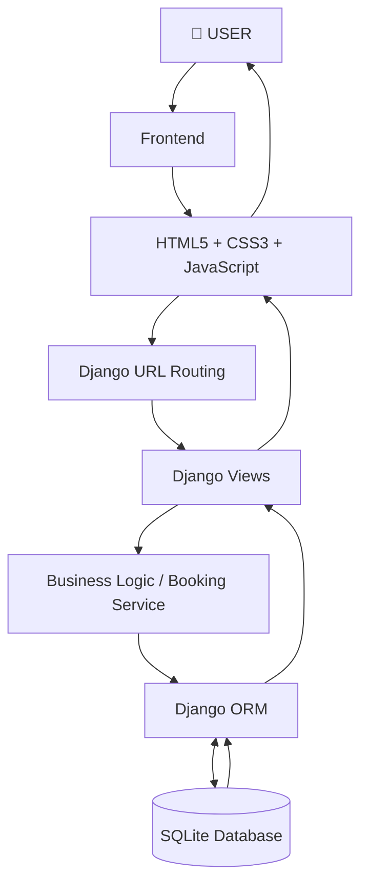
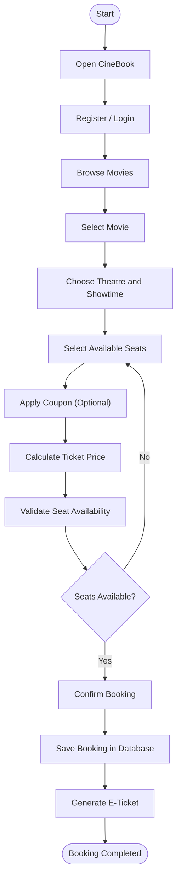
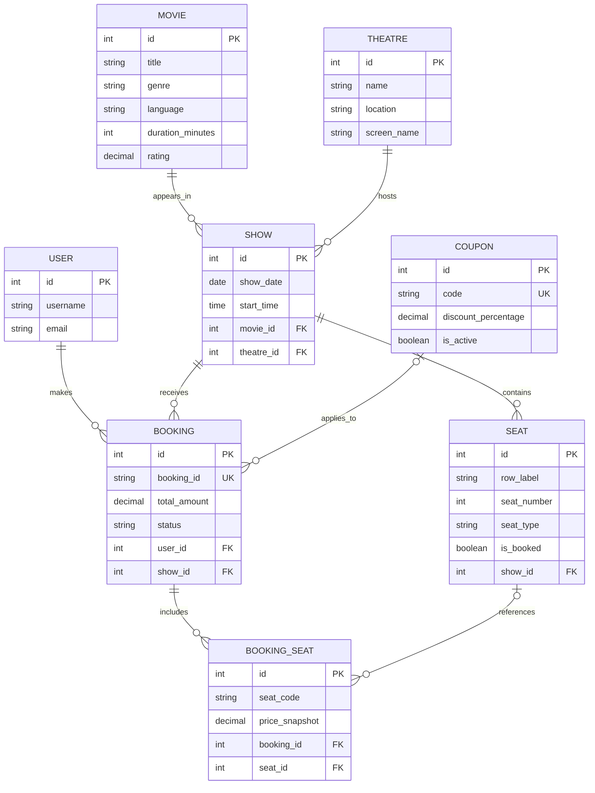
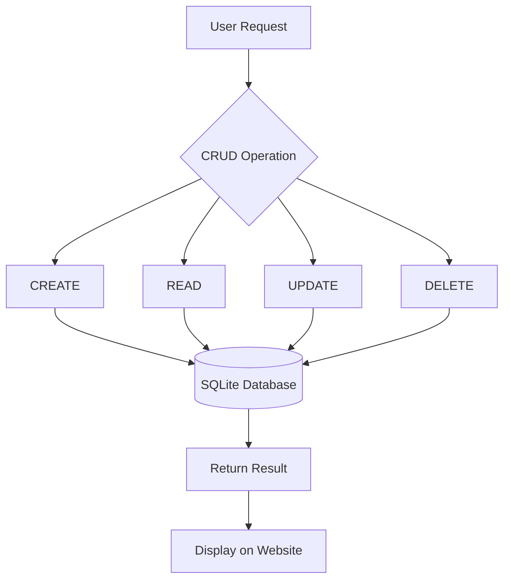

 <div align="center">

# 🎬 CineBook

### A Full-Stack Movie Ticket Booking System

**Discover Movies • Select Seats • Book Tickets • Manage Reservations**

[](https://www.python.org/)
[](https://www.djangoproject.com/)
[](https://www.sqlite.org/)
[](https://developer.mozilla.org/en-US/docs/Web/HTML)
[](https://developer.mozilla.org/en-US/docs/Web/CSS)
[](https://developer.mozilla.org/en-US/docs/Web/JavaScript)

<br>


### 🍿 Your Seat. Your Movie. Your Experience.

</div>

---

## 📌 1. About the Project

**CineBook** is a full-stack online movie ticket booking web application developed using Python, Django, SQLite, HTML, CSS, and JavaScript.

The main purpose of this project is to make movie ticket booking simple, convenient, and user-friendly.

Instead of visiting a cinema theatre and standing in a long queue, users can use CineBook to:

- Explore available movies.
- View movie details and ratings.
- Search and filter movies.
- Check available theatre showtimes.
- Select their preferred seats.
- Apply discount coupons.
- Confirm movie ticket bookings.
- View and print electronic tickets.
- Cancel their existing bookings.

CineBook provides a modern cinema experience with a **midnight-black background, cinematic-red buttons, and golden highlights**.

## 🎯 2. Project Objectives

1. Develop an easy-to-use online movie ticket booking platform.
2. Implement Object-Oriented Programming concepts.
3. Store and manage information using a relational database.
4. Implement database connectivity using Django ORM.
5. Perform CRUD operations on database records.
6. Prevent duplicate seat bookings.
7. Provide secure user registration and login.
8. Generate booking confirmations and electronic tickets.

## ✨ 3. Key Features

### 🎞️ Movie Discovery

- Featured blockbuster movie section.
- Now Showing movie collection.
- Coming Soon movie collection.
- Movie search by title, genre, and keyword.
- Genre and language filters.
- Movie ratings and descriptions.
- Movie duration and language information.

### 💺 Interactive Seat Selection

- Interactive 5 × 8 seating arrangement.
- 40 seats available for each show.
- Separate seat categories.
- Real-time seat availability.
- Selected and booked seat indicators.
- Automatic ticket price calculation.

### 🎟️ Ticket Booking

- Single-seat and multiple-seat booking.
- Unique booking reference generation.
- Discount coupon support.
- Automatic price calculation.
- Booking confirmation.
- Printable electronic tickets.

### 🔐 User Authentication

- User registration.
- User login.
- Authenticated booking operations.
- User-specific booking history.
- Booking ownership verification.

### ↩️ Cancellation Management

- View existing bookings.
- Cancel confirmed bookings.
- Automatic seat availability update.
- 80% refund calculation.
- Booking history preservation.

## 🖥️ 4. Application Screenshots

### 4.1 Homepage – Featured Movie

The homepage displays a featured movie with its rating, duration, language, description, and booking options.


### 4.2 Now Showing Movies

Displays currently available movies with movie posters, ratings, genres, languages, durations, and booking buttons.


### 4.3 Coming Soon Movies

Displays upcoming movie releases with release information and movie details.


## 🛠️ 5. Technology Stack

| Technology | Purpose |
|---|---|
| Python | Backend programming |
| Django | Web application framework |
| SQLite | Database management |
| HTML5 | Website structure |
| CSS3 | Styling and responsive design |
| JavaScript | Interactive frontend functionality |
| Django ORM | Database connectivity |
| Git & GitHub | Version control and project hosting |

### System Architecture

CineBook follows a three-layer application architecture.



**Simple Explanation:**

1. User opens the CineBook website.
2. HTML, CSS, and JavaScript display the website.
3. Django receives the user's request.
4. Django processes the request and checks the business rules.
5. Django ORM communicates with the database.
6. SQLite stores or retrieves the information.
7. The result is displayed to the user.

## 🏗️ 6. Project Workflow



## 🗃️ 7. Database Design

CineBook uses **SQLite** as its relational database.

The Django ORM connects the application to the database and manages the records.

### Entity Relationship Diagram (ER Diagram)



### Main Database Tables

| Table Name | Purpose |
|---|---|
| `auth_user` | Stores user account information |
| `movies_movie` | Stores movie information |
| `cinema_theatre` | Stores theatre information |
| `cinema_show` | Stores movie show schedules |
| `cinema_seat` | Stores seat availability |
| `bookings_booking` | Stores booking information |
| `bookings_bookingseat` | Stores booked seat details |
| `bookings_coupon` | Stores discount coupon details |

### Database Relationships

- One user can make multiple bookings.
- One movie can have multiple shows.
- One theatre can host multiple shows.
- One show can contain multiple seats.
- One booking can contain multiple seats.
- One coupon can be associated with eligible bookings.

### Database Snapshot

The supplied database snapshot contains the following records:

| Database Record | Count |
|---|---:|
| Movies | 6 |
| Theatres | 2 |
| Shows | 91 |
| Seats | 3,640 |
| Bookings | 8 |
| Booking Seats | 20 |
| Coupons | 1 |
| Users | 3 |

*These counts describe the supplied database snapshot and may change when the application is used.*

## 💡 8. Object-Oriented Programming (OOP) Concepts

CineBook is implemented using Python and Django. It demonstrates OOP concepts through Python classes, Django models, and service-layer design. It is not a Java/Spring application.

| OOP Concept | Implementation in CineBook |
|---|---|
| Class and Object | Django models such as Movie, Theatre, Show, Seat, and Booking |
| Encapsulation | Booking data and business operations are managed through classes |
| Inheritance | BookingService implements the Bookable abstract contract |
| Abstraction | Bookable abstract base class defines booking operations |
| Polymorphism | BookingService provides implementations of the abstract booking methods |
| Composition | A Theatre hosts Shows, and a Show contains Seats |

### Additional Programming Concepts

- **Enum:** `SeatType` defines seat categories and their prices.
- **Abstract Base Class:** `Bookable` defines the booking interface.
- **Service Layer:** `BookingService` manages booking and cancellation logic.
- **Two-Dimensional Array:** A 5 × 8 seat matrix is created using nested loops.
- **Database Relationships:** Foreign keys connect related records.

### Seat Layout Diagram

Each movie show has 40 seats arranged in five rows and eight columns.

```text
                  🎬 CINEMA SCREEN
          ┌──────────────────────────────┐
          │                              │
          │  A1 A2 A3 A4 A5 A6 A7 A8    │
          │  B1 B2 B3 B4 B5 B6 B7 B8    │
          │  C1 C2 C3 C4 C5 C6 C7 C8    │
          │  D1 D2 D3 D4 D5 D6 D7 D8    │
          │  E1 E2 E3 E4 E5 E6 E7 E8    │
          │                              │
          └──────────────────────────────┘

          A–B : REGULAR   ₹150
          C–D : PREMIUM   ₹250
          E   : VIP       ₹400
```

## 🔄 9. CRUD Operations

CRUD represents four basic database operations.

| Operation | Meaning | CineBook Implementation |
|---|---|---|
| CREATE | Add new data | Register users and create bookings |
| READ | Retrieve data | Display movies, shows, seats, and bookings |
| UPDATE | Modify existing data | Update booking status and seat availability |
| DELETE | Remove data | Delete records through applicable administrative or model operations |

### CRUD Workflow



**Important:** Normal booking cancellation does not permanently delete the booking. CineBook updates the booking status, records refund information, and releases the seats while preserving booking history.

## 💰 10. Ticket Pricing and Discount Calculation

CineBook uses different prices for different seat categories.

| Seat Category | Rows | Ticket Price |
|---|---|---:|
| Regular | A–B | ₹150 |
| Premium | C–D | ₹250 |
| VIP | E | ₹400 |

### Coupon System

CineBook supports the `CINE10` discount coupon.

- Discount percentage: 10%.
- Coupon validity is checked.
- Maximum discount rules are applied.
- Final ticket price is calculated by the backend.

**Example:**

Suppose a customer selects:

- 2 Regular seats = ₹300
- 1 Premium seat = ₹250

Subtotal = ₹550

10% discount = ₹55

**Final Amount = ₹495**

### Cancellation and Refund

The application calculates an 80% refund on the amount paid for an eligible cancelled booking.

Example:

Ticket amount = ₹500

Refund = ₹500 × 80%

Final refund = ₹400

The remaining 20% is retained as a cancellation fee.

## 🔐 11. Security Implementation

CineBook includes several security measures:

1. User authentication through Django.
2. Booking ownership verification.
3. Server-side seat validation.
4. Server-side price verification.
5. CSRF protection for state-changing requests.
6. Database transactions for booking operations.
7. Prevention of duplicate seat bookings.
8. Validation of coupon information.

**Database Transaction:** Booking operations use Django atomic transactions so that related database changes succeed or fail together.

**Note:** SQLite is suitable for this academic project. PostgreSQL is a recommended option for a high-traffic production deployment.

## 🧪 12. Testing

The project includes automated unit and integration test scenarios covering:

1. Seat category and price calculation.
2. Single-seat booking.
3. Multiple-seat booking.
4. Invalid seat validation.
5. Duplicate seat prevention.
6. Already-booked seat validation.
7. Booking transaction handling.
8. Coupon discount calculation.
9. Invalid coupon rejection.
10. Unique booking ID generation.
11. Independent seat layouts for different shows.
12. Booking cancellation.
13. Refund calculation.
14. Duplicate cancellation prevention.
15. Unauthorized booking cancellation.
16. Unauthorized ticket viewing.
17. Two-dimensional seat matrix generation.
18. Booking API workflow.

### Run Tests

```bash
python manage.py test
```

## 🚀 13. Installation and Execution

Follow these steps to run CineBook on your computer.

### Prerequisites

- Python 3.10 or later.
- pip package manager.
- Git.
- VS Code or another code editor.

### Step 1: Clone the Repository

```bash
git clone https://github.com/venkatpranav12/TICKET-BOOKING-WEBSITE-.git
```

### Step 2: Open the Project Folder

```bash
cd TICKET-BOOKING-WEBSITE-
```

### Step 3: Create a Virtual Environment

```bash
python3 -m venv .venv
```

Activate it on macOS/Linux:

```bash
source .venv/bin/activate
```

Windows:

```bash
.venv\Scripts\activate
```

### Step 4: Install Required Packages

```bash
pip install -r requirements.txt
```

### Step 5: Apply Database Migrations

```bash
python manage.py makemigrations
python manage.py migrate
```

### Step 6: Load Initial Project Data

```bash
python manage.py seed_cinebook
```

This documented management command creates sample movies, theatres, shows, seats, coupon information, and a demo account.

### Step 7: Run Automated Tests

```bash
python manage.py test
```

### Step 8: Start the Django Server

```bash
python manage.py runserver
```

### Step 9: Open the Application

Open your browser and visit:

```text
http://127.0.0.1:8000/
```

🎉 **CineBook is now running locally!**

## 📁 14. Project Structure

```text
TICKET-BOOKING-WEBSITE-/
│
├── README.md
├── manage.py
├── requirements.txt
├── db.sqlite3
│
├── homepage-featured.png
├── now-showing.png
├── coming-soon.png
│
├── config/
│   ├── settings.py
│   ├── urls.py
│   ├── views.py
│   ├── wsgi.py
│   └── asgi.py
│
├── core/
│   ├── enums.py
│   ├── interfaces.py
│   └── utils.py
│
├── movies/
│   ├── models.py
│   ├── views.py
│   └── urls.py
│
├── cinema/
│   ├── models.py
│   ├── views.py
│   ├── urls.py
│   └── management/
│       └── commands/
│           └── seed_cinebook.py
│
├── bookings/
│   ├── models.py
│   ├── views.py
│   ├── services.py
│   ├── forms.py
│   └── tests.py
│
├── templates/
│   ├── base.html
│   ├── movies/
│   ├── cinema/
│   ├── bookings/
│   └── registration/
│
└── static/
    ├── css/
    │   └── style.css
    └── js/
        ├── app.js
        └── seat-map.js
```

*The structure above describes the documented application layout. Your root-level screenshot files are intentionally referenced directly in this README.*

## 🔮 15. Future Enhancements

The following features can be added in future versions:

- Online payment gateway integration.
- QR-code-based ticket verification.
- Email and SMS booking notifications.
- Movie reviews and user ratings.
- Admin analytics dashboard.
- More advanced recommendation system.
- Cloud deployment.
- PostgreSQL database integration.

*These are proposed improvements, not claims of existing functionality.*

## 👨‍💻 16. Project Information

| Detail | Information |
|---|---|
| Project Name | CineBook |
| Project Type | Full-Stack Web Application |
| Domain | Web Development |
| Backend | Python and Django |
| Frontend | HTML, CSS, JavaScript |
| Database | SQLite |
| Development Tool | VS Code |
| Version Control | Git and GitHub |

### Developed By

**VENKAT PRANAV**

GitHub: [@venkatpranav12](https://github.com/venkatpranav12)

Project Repository: [CineBook – Movie Ticket Booking System](https://github.com/venkatpranav12/TICKET-BOOKING-WEBSITE-)

*Add the remaining team members' names and actual contributions here, if applicable.*

## 📄 17. License

This project is developed for academic and educational purposes.

A separate open-source license can be added if the project is intended for public distribution.

---

<div align="center">

# 🎬 CINEBOOK

### YOUR SEAT. YOUR MOVIE. YOUR EXPERIENCE.

**Discover • Select • Book • Enjoy**

Made with ❤️ using Python, Django, SQLite, HTML, CSS and JavaScript.

⭐ If you like this project, consider giving the repository a star!

</div> 


